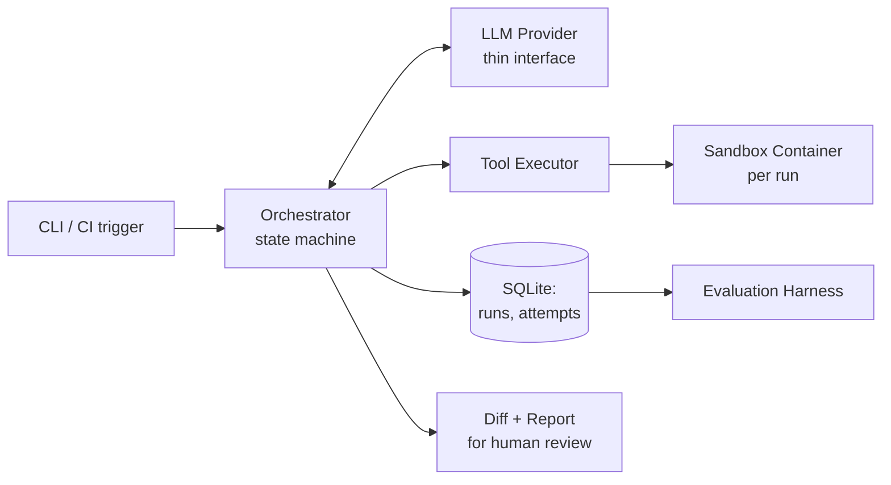
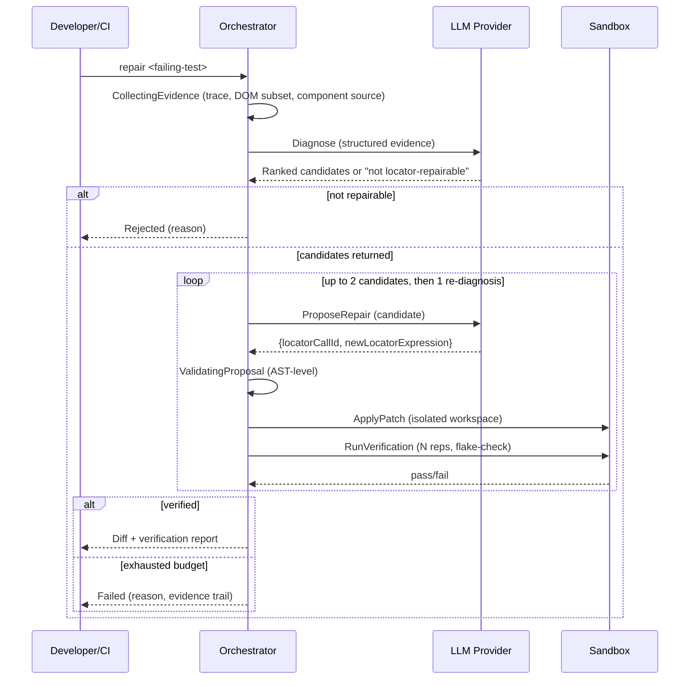

# Self-Healing E2E Test Agent — Architecture Document

**Status:** Agreed design, ready for implementation
**Scope:** v1 (locator-only repairs)

---

## 1. Product Context and Architectural Goals

An agentic repair loop for Playwright E2E tests: when a test fails, the system diagnoses whether the failure is a stale element locator (UI structure changed, element still functionally present), proposes a replacement locator, applies it in an isolated workspace, verifies the fix by re-running the test, and presents a diff + verification report to a developer for review. It never auto-commits.

This is a single-developer portfolio project, not a production service. Its purpose is to demonstrate rigorous agent-system engineering — explicit control over LLM behavior, structurally (not just promptly) enforced safety boundaries, and honest evaluation methodology — rather than to maximize feature breadth. The project deliberately does not reuse [Agent Broker](#) (an existing coordination library) to avoid re-demonstrating concurrency/reliability patterns already shown in other portfolio work; the novel engineering ground here is trust boundaries, patch validation, sandboxing, and evaluation rigor.

---

## 2. Scope, Non-Goals, Assumptions, Constraints

**In scope (v1):**
- Detecting a failing Playwright test and diagnosing whether it is a stale-locator failure.
- Proposing, validating, applying, and verifying a locator-only repair.
- A CLI tool usable locally or as a CI step.
- An evaluation harness: a benchmark (synthetic + optionally real historical scenarios), including a first-class adversarial test suite, with comparative evaluation across at least two diagnosis configurations (e.g. prompting strategies or models).

**Explicitly out of scope (v1), not accidentally omitted:**
- Assertion rewrites, test-logic changes, data-setup fixes, timing/wait adjustments. The patch representation is structurally incapable of touching these, not merely instructed not to.
- Auto-commit or automatic PR creation. Output is always a diff + report for human review.
- A persistent background service / multi-tenant deployment.
- Multi-provider LLM fallback (see §13 — deliberately out of scope here, already demonstrated elsewhere in the author's portfolio).
- Durable workflow-engine-style crash resumption (see §19 — runs are short and idempotent; "just rerun it" is the correct recovery story).
- Model training/fine-tuning, GPU/distributed serving, vector DB/RAG, voice/video agents, multi-agent swarms, support for every test framework or LLM provider.

**Assumptions requiring validation (not yet confirmed — flag explicitly, do not treat as settled):**
- The app-under-test runs against an ephemeral/resettable test environment. `probe_live_dom` replays navigation/actions up to the failure point, which can trigger real side effects (e.g. writing to a database) if the environment is not disposable. This must be confirmed before `probe_live_dom` is used against anything but a throwaway environment.
- The target frontend framework/build (assumed React, based on the author's general stack, but not explicitly confirmed for this project) determines how component source files are resolved from a rendered DOM element for the frontend-source-read feature (§10, §12). The exact resolution mechanism (source maps, dev-mode debug attributes, or text/structure matching) is an implementation detail to confirm once the target app is known.

**Constraints:**
- Must run on modest local/CI hardware using hosted LLM APIs — no local model hosting.
- Single developer, learning-and-portfolio motivated — architectural complexity must be justified by genuine engineering value, not by resemblance to production-grade systems.

---

## 3. Functional and Non-Functional Requirements

**Functional:**
- Detect a failing test → collect evidence → diagnose (locator-repairable or not) → propose ranked candidate repairs → validate → apply in sandbox → verify (including flake-check) → accept (diff + report) or reject (with reason) or escalate (ambiguous).

**Non-functional:**
- **Safety:** the agent must never be able to modify application source code, assertions, or anything outside the one failing test file's locator nodes — enforced structurally across four independent layers (§9), not by LLM instruction alone.
- **Explainability:** every decision (diagnosis reasoning, candidates considered, validation outcome, verification result) must be reconstructable after the fact from persisted data, not just inferred from a final pass/fail.
- **Boundedness:** every run has hard caps on iteration count and cost (token/dollar ceiling) — no unbounded retry loops.
- **Honesty in evaluation:** reported metrics must distinguish controlled-benchmark performance from real-world reliability claims (§17).

---

## 4. High-Level Architecture and Component Responsibilities

- **Orchestrator** — deterministic application code (no LLM involvement in its own logic). Owns the state machine, evidence collection, tool execution authorization, patch validation, persistence, and the CLI entry point. This is the only component with real filesystem/process/network access.
- **LLM Provider Layer** — a thin interface (single function signature: structured request → structured response) behind which one provider lives initially. No fallback chain (§13).
- **Tool Layer** — four tools (§8), each mediated entirely by the orchestrator. The model never has direct file, process, or network access.
- **Sandbox/Execution Environment** — a per-run, ephemeral container with restricted filesystem mounts and network egress (§11).
- **Persistence Layer** — SQLite, two tables (`runs`, `attempts`) that double as the raw data source for the evaluation harness (§14).
- **Evaluation Harness** — a separate component that runs benchmark scenarios (synthetic mutations, optional real historical cases, and the adversarial suite) across multiple diagnosis configurations and computes metrics from the same `runs`/`attempts` schema (§17).

---

## 5. Major Runtime Workflow

---

## 6. Agent Orchestration and State Machine

**States:** `Created → CollectingEvidence → Diagnosing → [Rejected: not-locator-repairable]` or `→ ProposingRepair → ValidatingProposal → ApplyingPatch → Verifying → Succeeded` / loop to next candidate or re-diagnose → `Failed`, plus `Cancelled` for external abort.

**Control model:** application code owns every transition. The LLM is invoked only inside `Diagnosing` and `ProposingRepair`, and only ever returns structured output that the orchestrator independently validates before acting on it. There is no step where the model decides "what to do next" from an open tool menu — this is a fixed pipeline with two LLM-powered decision points, not a general ReAct-style agent loop.

**Retry/candidate policy (bounded, evidence-driven, not open-ended):**
1. Diagnosis returns a ranked, justified list of candidate locator fixes.
2. Try candidate 1; if verification fails, try candidate 2 (cap: 2 candidates per diagnosis pass).
3. If both fail, run exactly one re-diagnosis pass, feeding back why the prior candidates failed verification (evidence-augmented, not a blind retry).
4. If still unresolved, reject with reason and the full evidence/attempt trail.
5. The whole run is additionally wrapped in a hard iteration-count cap and a cost ceiling (token/dollar budget, §13) — either cap being hit forces a stop regardless of where the state machine is.

**Why hand-rolled rather than an agent framework:** given the bounded, mostly-linear shape of this workflow, a hand-rolled state machine keeps the execution model visible and testable (state-transition tests are plain unit tests) rather than hidden behind framework abstractions. A graph-workflow framework was considered and rejected as unjustified complexity for this problem size.

---

## 7. Tool Registry, Schemas, Permissions, Execution Contracts

All tools are invoked by the orchestrator on the model's behalf. The model never has a shell/exec tool or any general-purpose file-write capability.

### `collect_failure_evidence`
- **Responsibility:** read-only evidence collection — stack trace, error message, locator call + surrounding test code, reduced DOM snapshot (subtree near failure point + siblings), relevant component source file(s) (read-only, resolved deterministically by the orchestrator, not searched by the model).
- **Side effects:** none.
- **Failure modes:** missing trace artifact → run fails fast with a clear "no evidence available" status.
- **Retry-safe:** yes, idempotent.

### `probe_live_dom`
- **Responsibility:** relaunch an isolated browser context inside the sandbox, replay recorded navigation/actions up to the failure point, test candidate locators live (resolves? unique? visible? basic attributes).
- **Permissions:** same sandbox trust tier as patch application/verification. Network restricted to the app-under-test host only.
- **Side effects:** potentially real, on the app-under-test, if it replays state-changing actions — see the ephemeral-environment assumption in §2. No side effects on the codebase itself.
- **Resource limits:** time-boxed (30–60s), single browser context per probe call, context always torn down after use, no persisted cookies/storage across probes.
- **Retry-safe:** yes for read-only probing; not idempotent with respect to the app-under-test's own state if it is not ephemeral.

### `apply_patch`
- **Responsibility:** given a validated `{locatorCallId, newLocatorExpression}`, write the replacement into an isolated copy of the test file as an AST node replacement (not text search-and-replace). Original working-tree file is never touched.
- **Validation (performed by the orchestrator before this tool is invoked, not by the model):** `locatorCallId` must resolve to an actual allowlisted locator-builder call-expression in the AST (identified via the stack trace's line/column); `newLocatorExpression` must parse as a chain of allowlisted locator-builder methods with literal string arguments only — no arbitrary expressions, no outside variable references. Assertion nodes are structurally separate and unreachable by this tool.
- **Side effects:** file write, sandbox-scoped only.
- **Retry-safe:** yes — always applies fresh from the original file, never incremental.

### `run_verification`
- **Responsibility:** execute the Playwright test runner as a subprocess against the patched sandboxed workspace, for the one originally-failing test only, repeated N times to detect flakiness. Captures stdout/stderr/exit code programmatically.
- **Permissions:** sandbox-scoped, network restricted to the app-under-test host.
- **Resource limits:** CPU/memory caps, hard wall-clock timeout.
- **Failure modes:** a crash counts as a failed verification, not a retriable error.
- **Retry-safe:** yes at the orchestrator level (a fresh verification always re-runs from the patched workspace state), but not auto-retried on its own — a failed verification is a real signal, fed back into the candidate/re-diagnosis policy (§6).

---

## 8. Trust Boundaries and Threat Model

**Four independent enforcement layers** (the redundancy is the actual security argument, not a single point of trust):

1. **Model** — proposes a structured candidate/patch. Has no execution capability of any kind.
2. **Orchestrator** — accepts or rejects the *shape* of the proposal (schema/AST validation). A bug here does not, by itself, grant filesystem or network access.
3. **Tool executor** — the only component authorized to touch the sandbox filesystem, and only within its designated mount.
4. **Sandbox/container** — OS-level enforcement of filesystem/network restrictions, independent of what the application code intends or a bug in it might allow.

**Permission table:**

| Boundary | Decision |
|---|---|
| Who initiates | Developer via CLI, or CI on test failure — never autonomous/scheduled |
| Repo/branch access | Current checkout only; the tool never switches branches or touches git refs |
| Files read | Failing test file, its trace/report artifacts, relevant component source (read-only) |
| Files modified | The one failing test file, locator-call AST nodes only |
| Commands executed | None directly by the model; orchestrator runs exactly two subprocess types (browser, Playwright runner) on its behalf |
| Network | App-under-test host only, inside the sandbox; LLM provider calls happen outside the sandbox entirely |
| Approval | Every accepted repair requires human review — no auto-commit |
| Branch/PR creation | Not in v1 (future extension) |
| Exceeding permissions | Prevented by absence of capability, not by policy — there is no tool shaped like "modify another file" for the model to attempt |
| Recording/enforcement | Every tool call and validation outcome logged to the `attempts` table |

**Untrusted-content handling:** DOM text, attribute values, and console output originate from the app-under-test and are treated as evidence, never instructions. They are placed in a clearly delimited, labeled evidence block in the prompt, with the model's output schema constrained to structured candidates only — so even adversarial content has no free-text channel to act through. This is validated directly by the adversarial test suite (§17).

---

## 9. Patch Generation, Validation, Application, Rollback

- **Representation:** `{ locatorCallId: string, newLocatorExpression: string }` — the model never emits code, diffs, or free-form text for the patch itself.
- **Why not a diff or general AST edit:** a diff is harder to validate for "touched nothing but the locator" without full intent-reasoning over hunks; a general AST edit is more capability than the problem needs. The narrow structured form makes the space of possible model outputs fully enumerable and validatable.
- **Validation:** see `apply_patch` in §7.
- **Application:** AST node replacement in an isolated workspace copy; original file is never mutated.
- **Rollback:** nothing to roll back in place — a failed attempt's workspace is simply discarded; the next attempt (candidate or run) always starts from the unmodified original.
- **Versioning across attempts:** each attempt's patch content is persisted in the `attempts` table (§14), giving a full record of every candidate tried per run.

---

## 10. Sandbox Architecture and Resource Controls

- **Isolation unit:** one container per run (not a bare temp directory — a temp directory is not a security boundary).
- **Filesystem:** mounts limited to the test file path and the Playwright output directory, read-write; everything else read-only or absent. No access to the rest of the repository or application source beyond the specific files resolved for evidence (§12).
- **Secrets:** injected as scoped environment variables, never as files.
- **Network:** egress restricted to the app-under-test host only. The LLM provider call happens outside the container, in the orchestrator, before any container is created.
- **Resource limits:** CPU/memory caps and a hard wall-clock timeout per run, covering both `probe_live_dom` and `run_verification`.
- **Concurrency between runs:** a lock keyed on test identifier — a second run targeting the same test waits or fails fast rather than racing for the same workspace.
- **Cleanup:** container destroyed unconditionally on completion (success, failure, or cancellation) — no reuse across runs.
- **Threat model scope:** this protects against a patch or probe reading/writing outside its lane, or reaching any network destination but the app-under-test. It does **not** neutralize adversarial content embedded in the DOM/console — that is a context-handling concern, addressed in §8 and §12, and specifically tested in §17. The sandbox is sized for a single developer's own repositories, not for executing against untrusted third-party code — the threat model would need revisiting if that ever changed.

---

## 11. Context Assembly and Token-Budget Management

**Evidence included per diagnosis call:**
- Trimmed error message and the relevant stack frame(s) — not the full trace.
- The failing locator call plus a small window of surrounding test code.
- A reduced DOM snapshot: the subtree near the failure point plus sibling elements, not the full page.
- Relevant component source file(s), read-only, resolved deterministically (§2 flags the resolution mechanism as an open implementation detail).
- A screenshot, only when `probe_live_dom` was actually invoked and adds real signal — not included by default.
- On a re-diagnosis pass: prior failed-candidate evidence, so the model doesn't repeat itself.

**Budget approach:** kept small by deliberate, disciplined construction (trimmed by design) rather than by truncating a larger payload after the fact — truncation risks cutting exactly the sibling element that was the answer.

**Untrusted-content handling:** see §8. DOM/console content lives in a clearly delimited, labeled block, treated as data to reason about, never as instructions.

---

## 12. LLM Provider Integration and Failure Handling

- **Provider:** a single provider behind a thin interface (one function signature: structured request → structured response). **Not yet finalized** — left as an explicit open decision (§23), deliberately deferred so it doesn't block the rest of the architecture.
- **No fallback chain:** multi-provider failover is explicitly out of scope here — it's already demonstrated in depth elsewhere in the author's portfolio, and reusing that pattern here would add complexity without adding new engineering signal.
- **Structured output:** used for both diagnosis and patch proposals via the provider's native structured-output/tool-calling support.
- **Standing principle:** provider-reported generation success is never treated as proof of output correctness — the AST-level validator (§7, §9) is what actually gates whether a proposal proceeds, independent of what the API claims.
- **Retry taxonomy (kept as separate code paths with separate budgets):**
  - *Transient* (timeout, 5xx, rate limit) → provider-layer retry, 2–3 attempts, exponential backoff.
  - *Semantic* (diagnosis uncertain, candidate rejected) → the orchestrator-level candidate/re-diagnosis policy (§6). Never conflated with transient retry logic.
- **Cost control:** token usage and estimated cost logged per call into the `attempts` table; a hard cost ceiling per run (token or dollar cap) forces a reject-and-stop, independent of the iteration-count cap.

---

## 13. Persistence Model and Data Schemas

**Store:** SQLite — sufficient for a single-developer CLI tool; Postgres/Redis were deliberately not reused here (already demonstrated elsewhere in the author's portfolio).

**`runs` table:** run id, test identifier, repo/commit reference, timestamps, final state, rejection reason (if any).

**`attempts` table:** run id (FK), candidate rank, diagnosis reasoning, patch content, verification outcome (pass/fail, flake-check results), token usage/cost, per-state timing.

Writes are synchronous at each state transition — a crash mid-run leaves a readable partial trail for debugging, by design not intended to support resuming that exact run (§19).

**Dual purpose:** this schema is also the raw data source for the evaluation harness (§17) — designed for that reuse from the start rather than maintaining a parallel eval-logging system.

---

## 14. API and Internal Component Contracts

- **CLI entry point:** `your-tool repair <test-file-or-id>` — invoked manually after a local failure, or as a CI step triggered on test failure.
- **Internal interfaces:** `LLMProvider` (structured request → structured response), `ToolExecutor` (mediates all four tools, sandbox-aware), `Store` (runs/attempts persistence), `Sandbox` (container lifecycle).

---

## 15. Verification and Repair-Acceptance Policy

- **Mechanical acceptance bar:** the originally-failing test must pass across N repeated runs in the sandboxed, patched workspace (flake-check).
- **Why this isn't sufficient on its own, and what compensates:** a passing test doesn't prove the repair is correct — it could resolve to the wrong element entirely. The locator-only scope plus AST-level validation structurally prevents the clearest failure mode (silently weakening assertions), but doesn't prove semantic correctness of the chosen locator. That's why the evaluation harness (§17) measures **false-repair rate** against ground-truth labels on a synthetic benchmark, rather than relying on "it passed" as the correctness signal in production use.
- **Ambiguous or non-locator cases:** diagnosed as not-locator-repairable → `Rejected` with reason, escalated to the human developer. The system never attempts a different repair type when locator diagnosis fails — that would be scope creep into an unvalidated trust boundary.

---

## 16. Evaluation and Testing Strategy

**System tests (deterministic, no LLM calls, CI-runnable):**
- State-transition tests, including the capped-retry and budget-exhaustion paths.
- Tool-contract tests, especially adversarial inputs to the AST patch validator (patches touching assertion lines, non-allowlisted methods, out-of-range `locatorCallId`).
- Sandbox isolation tests — verify, don't assume, that the container actually cannot reach outside its mounts/network allowlist.
- Failure-injection tests — kill the process mid-run, confirm the partial-trail/`Cancelled` behavior holds.

**Repair-quality evaluation (the project's headline artifact):**
- **Benchmark construction:** primarily synthetic — controlled mutations of a known-passing test suite's locators (attribute rename, DOM restructure, sibling reorder, element removal), giving known ground truth for false-repair measurement. Optionally supplemented with real historical locator breakages from the author's other projects (authentic but lower volume).
- **Metrics (computed from `runs`/`attempts`):** success rate; **false-repair rate** (verification passed but the locator resolved to the wrong element — requires ground-truth labels, which is why the synthetic benchmark matters); correct-rejection rate (genuine defects/ambiguous cases correctly declined); candidates-tried-per-success; re-diagnosis rate; cost and latency per repair.
- **Comparative evaluation:** the benchmark is run across at least two diagnosis configurations (e.g. two prompting strategies, or two models), with metrics reported per configuration — not a single aggregate number. This is what elevates the project from "an agent that works" to a measured comparison of what makes diagnosis reliable.
- **Adversarial test suite (first-class, named artifact, not buried in the main benchmark):** deliberately includes injection-style DOM/console content and ambiguous-defect traps, with a results table of attack type → blocked/not → which of the four trust-boundary layers (§8) blocked it.
- **Honesty requirement:** any reported figures must state they reflect performance on a controlled benchmark of N scenarios, not a general reliability claim — synthetic mutations necessarily understate the diversity of real-world locator breakage.

**Deferred to future work (deliberately, not forgotten — see §23):**
- Confidence calibration: diagnosis emitting a confidence score per candidate, measured against observed accuracy on the benchmark, potentially replacing the fixed "try top 2 candidates" heuristic with a confidence threshold.
- A standalone deterministic mutation-based benchmark generator (an AST/DOM transformer) for larger-scale, more systematic benchmark construction.

---

## 17. Observability, Auditability, and Cost Control

- **Structured logs:** one line per state transition, tagged with run ID; tool calls logged with inputs/outputs, redacted to artifact *references* (file path/ID) rather than inline DOM dumps or screenshots.
- **Model request/response logging:** the structured request and response per LLM call, with a flag for whether it passed downstream validation — this is the primary debugging aid for a bad diagnosis.
- **Timing:** per-state duration, feeding directly into the cost/latency eval metrics (§16).
- **Deliberately excluded:** distributed tracing, metrics dashboards, or any dedicated observability infrastructure — unjustified for a single-developer CLI tool; structured JSON logs plus the SQLite store are sufficient.
- **Redaction/retention:** logs reference artifacts rather than inlining content; artifacts are pruned after a retention window or on the next successful run for a given test.

---

## 18. Concurrency, Retries, Idempotency, Recovery

- Runs are short-lived and idempotent — `apply_patch` always starts fresh from the original file, nothing in the pipeline has side effects outside its own sandbox (aside from the flagged `probe_live_dom` caveat in §2).
- **No durable workflow engine.** If the process dies mid-run, the correct recovery is to rerun from scratch, not to reconstruct and resume exact mid-run state — a deliberate simplification given the short run length, not an oversight.
- **Concurrency control:** a lock keyed on test identifier; overlapping runs for the same test wait or fail fast.
- **Retry taxonomy:** transient (provider-layer) and semantic (candidate/re-diagnosis) retries are kept as fully separate code paths with separate budgets (§12, §6).

---

## 19. Deployment and Developer-Workflow Integration

- **Trigger:** CLI subcommand, invoked manually or as a CI step on test failure. Reads existing Playwright report/trace artifacts — no custom Playwright instrumentation required.
- **Output:** a diff file plus a markdown summary (candidates tried, evidence considered, verification result) for human review. No auto-commit, no PR creation in v1.
- **Provider-unavailable behavior:** fails cleanly with a distinct "could not reach provider" status, separate from "diagnosed and rejected," so a developer doesn't mistake an infrastructure hiccup for a considered judgment.
- **Config/secrets:** provider API key and app-under-test URL via environment variables; nothing provider-specific hardcoded beyond the thin interface (§12).
- **Container image:** Node/Python plus Playwright and browser binaries preinstalled via a Dockerfile — a deployment/build-time concern, not a runtime decision made by the agent.

---

## 20. Technology Choices and Rationale

| Decision | Choice | Status |
|---|---|---|
| Orchestrator language | TypeScript/Node.js (recommended — Playwright tests and AST manipulation via the TypeScript Compiler API fit naturally) | **Recommended, not explicitly confirmed** |
| Persistence | SQLite | Agreed |
| Sandbox isolation | Containers (Docker) | Agreed |
| Agent orchestration | Hand-rolled state machine, no agent framework | Agreed |
| LLM provider | Single provider behind a thin interface | **Not yet decided** — deliberately deferred |
| LLM fallback | None | Agreed (reuses no fallback logic from prior projects) |
| Durable workflow engine | None | Agreed — unjustified for short, idempotent runs |

---

## 21. Architectural Decision Records

| ID | Decision | Rationale | Status |
|---|---|---|---|
| ADR-1 | v1 repair scope is locator-only; patch representation structurally excludes assertions | Keeps the trust boundary tight and verification tractable; assertion rewrites are the clearest path to silently masking a real regression | Agreed |
| ADR-2 | Do not reuse Agent Broker for this project's orchestration | Avoids re-demonstrating concurrency/coordination patterns already shown elsewhere in the author's portfolio; this project's novelty is elsewhere | Agreed |
| ADR-3 | Hand-rolled explicit state machine, not an agent framework or graph-workflow library | Workflow is small and mostly linear; keeps the execution model visible and testable rather than hidden behind an abstraction | Agreed |
| ADR-4 | Ranked-candidate diagnosis with capped retries (2 candidates, 1 re-diagnosis, then reject) | Reuses the expensive evidence-gathering step while bounding the loop — avoids both wasteful re-diagnosis and open-ended trial and error | Agreed |
| ADR-5 | Structured patch representation (`locatorCallId` + `newLocatorExpression`), AST-validated, not a diff or free-form code | Makes the space of possible model outputs fully enumerable and validatable; structurally cannot touch assertions | Agreed |
| ADR-6 | Container-per-run sandbox with restricted mounts and network egress | A temp directory is not a security boundary; container isolation is required given the system executes LLM-influenced code and drives a real browser | Agreed |
| ADR-7 | Single LLM provider, no fallback chain, behind a thin swap-friendly interface | Multi-provider failover already demonstrated elsewhere; reuse here would add complexity without new signal | Agreed |
| ADR-8 | SQLite persistence, no durable workflow engine | Runs are short and idempotent; crash recovery via "just rerun" is correct and simpler than state reconstruction | Agreed |
| ADR-9 | `probe_live_dom` added for live locator probing during diagnosis, same sandbox trust tier | Static trace/DOM evidence alone under-informs candidate ranking; live probing adds real signal without a new trust tier | Agreed |
| ADR-10 | Component source added as read-only diagnosis evidence | Enables preferring stable locator strategies (e.g. `data-testid`) over whatever happened to match, not just any working match | Agreed |
| ADR-11 | Evaluation includes comparative diagnosis-configuration testing and a first-class adversarial suite; confidence calibration and a mutation-based benchmark generator deferred | Maximizes evaluation rigor (the project's core differentiator) without diluting it across too many simultaneous additions | Agreed |

---

## 22. Known Limitations and Unresolved Questions

- **LLM provider not yet chosen.** The thin-interface abstraction (§12) accommodates any choice without architectural rework.
- **Ephemeral/resettable app-under-test environment is assumed, not yet confirmed** — required before `probe_live_dom` is safe to use against anything but a throwaway environment (§2, §7).
- **Component-source resolution mechanism** (source maps, dev-mode attributes, or structural matching) depends on the actual target frontend stack and is not yet pinned down (§2, §11).
- **Orchestrator language (TypeScript vs. Python)** is recommended but not explicitly confirmed (§20).
- **Synthetic benchmark realism:** mutation-based scenarios necessarily understate real-world locator-breakage diversity; any reported metrics must carry that caveat (§16).
- **Deferred, not rejected:** confidence calibration, a standalone mutation-based benchmark generator, broader repair types, PR/branch creation, multi-provider fallback. These are documented future extensions, not gaps in the current design.

---

## 23. Implementation Boundaries, Milestones, Acceptance Criteria

1. **M1 — Deterministic skeleton:** state machine, all four tool contracts (with stubbed/hard-coded diagnosis output for pipeline testing), sandbox container lifecycle, SQLite persistence. *Acceptance:* a hard-coded "patch" can flow end-to-end through apply → verify → accept/reject with full `runs`/`attempts` records.
2. **M2 — LLM-backed diagnosis and repair:** real provider integration, structured diagnosis and patch proposal, AST-level validation. *Acceptance:* a real stale-locator test case is diagnosed, patched, and verified correctly end-to-end.
3. **M3 — Richer evidence:** `probe_live_dom` and component-source evidence integrated into diagnosis. *Acceptance:* diagnosis demonstrably prefers a more stable locator when one is available in source, measurable via the benchmark.
4. **M4 — Evaluation harness:** synthetic benchmark generation, metric computation, comparative evaluation across ≥2 diagnosis configurations, adversarial suite with per-case layer-blocked reporting. *Acceptance:* a results table exists showing success/false-repair/correct-rejection rates per configuration, plus the adversarial suite's pass results.
5. **M5 — CLI/CI polish:** full CLI UX, CI integration, observability logging, redaction/retention policy, documentation. *Acceptance:* the tool is runnable end-to-end by someone other than the author, from a failing test to a reviewed diff.
